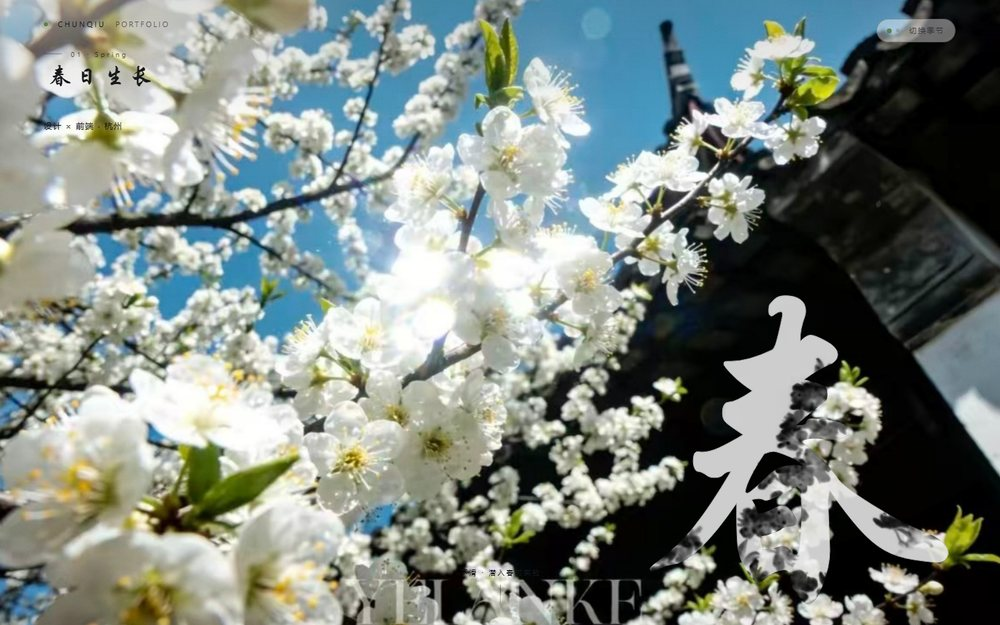
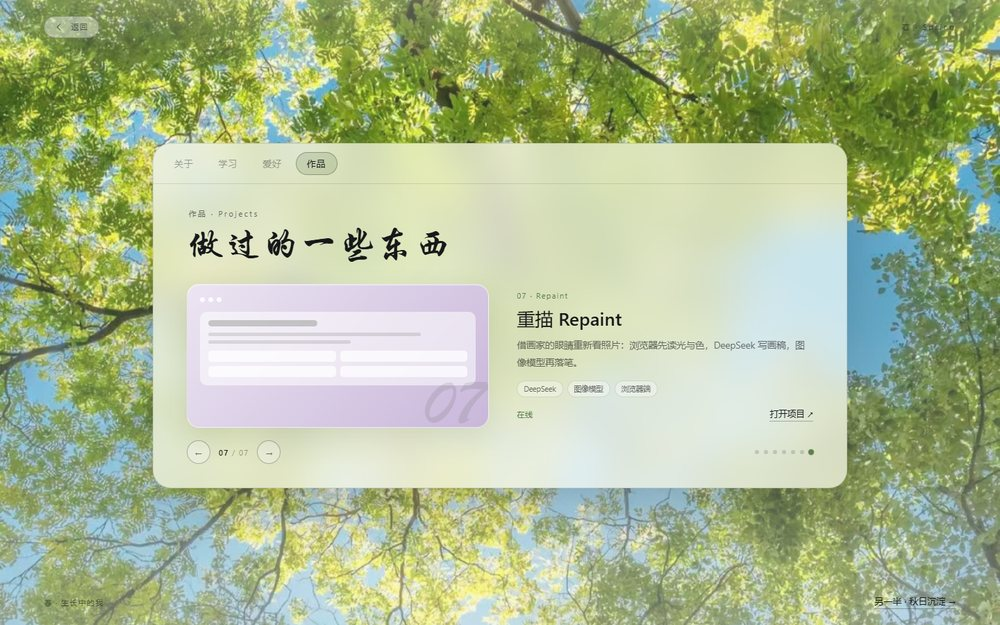
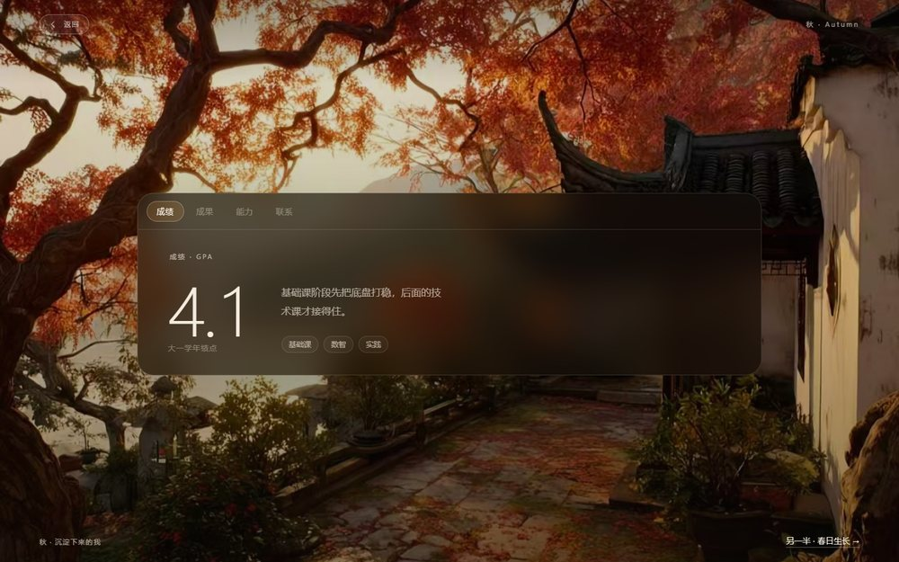

# 春秋 · Chunqiu

以「春 / 秋」两种形态呈现的个人作品集。春是生长，秋是沉淀；封面下滑，春以流水入，秋以落叶入。

**在线访问：** <https://2006chunqiu.github.io/chunqiu/>



## 它是什么

一个不滚长页的个人站点：封面只有春与秋两个入口，进入后每个季节是一屏，内容在标签之间切换。七个作品、学习经历、成绩与能力都收在这一屏里。

## 页面结构

- **春 · 生长中的我**：关于 / 学习 / 爱好 / 作品
- **秋 · 沉淀下来的我**：成绩 / 成果 / 能力 / 联系

## 交互

- 封面双季：春·花枝、秋·红枫，可点击或按 `←` / `→` 切换；下滑进入对应季节。
- 季节过渡：春以流动的波纹上涌，秋以枫叶飘落。
- 标签胶囊会滑动到当前项，内容按方向滑入；面板高度随标签内容自适应。
- 学习经历是手风琴，点开一段、收起其他段。
- 绩点进入时从 0 滚到 4.1。
- 能力页的开发流程可逐步点选，下方说明随之变化。
- 作品轮播支持左右按钮、圆点、方向键与 `?proj=3` 深链。
- 联系页可一键复制邮箱。
- 桌面端有指针光晕与底片视差；移动端自动降级。
- 支持 `prefers-reduced-motion`，键盘可操作。



## 作品

| # | 项目 | 技术 |
|---|---|---|
| 01 | 个人作品集网站 | React · TypeScript · Tailwind |
| 02 | 待办清单 · 进阶版 | Zustand · date-fns · LocalStorage |
| 03 | Markdown 笔记 | react-markdown · Prism · LocalStorage |
| 04 | 番茄钟计时器 | Notification API · Web Audio · LocalStorage |
| 05 | 天气查询应用 | Open-Meteo API · Geolocation · LocalStorage |
| 06 | 智能通知系统 | Codex · AI 辅助开发 · Web |
| 07 | 重描 Repaint | DeepSeek · 图像模型 · 浏览器端 |

> 「智能通知系统」部署在 `http://218.197.118.44:8848`，访问需要登录；其余作品链接指向各自线上地址。



## 技术

- 单个 `index.html`，CSS 与 JavaScript 全部内联，无框架、无构建步骤。
- 图片在 `assets/`，使用系统字体与行楷字体栈。
- 响应式布局；移动端单屏标签，不产生整页滚动。
- 部署在 GitHub Pages，`main` 分支根目录。

## 本地预览

```bash
python -m http.server 8000
```

然后打开 <http://localhost:8000>。也可以直接用浏览器打开 `index.html`（`file://` 下剪贴板复制可能受限）。

## 目录

```text
index.html
assets/
  spring-hero.jpg
  autumn-hero.jpg
  spring-page.jpg
  autumn-page.jpg
preview/
  hero-spring.jpg
  spring-work-7.jpg
  autumn-view.jpg
  hero-mobile.jpg
README.md
.nojekyll
```

## 说明

- 作品数据来自早前的工具作品集与后续项目；封面按春页色系重绘，避免深色截图破坏整体色调。
- 页面不收集访客数据，没有后端；「复制邮箱」只在本地剪贴板操作。

## 联系

3402990356@qq.com
